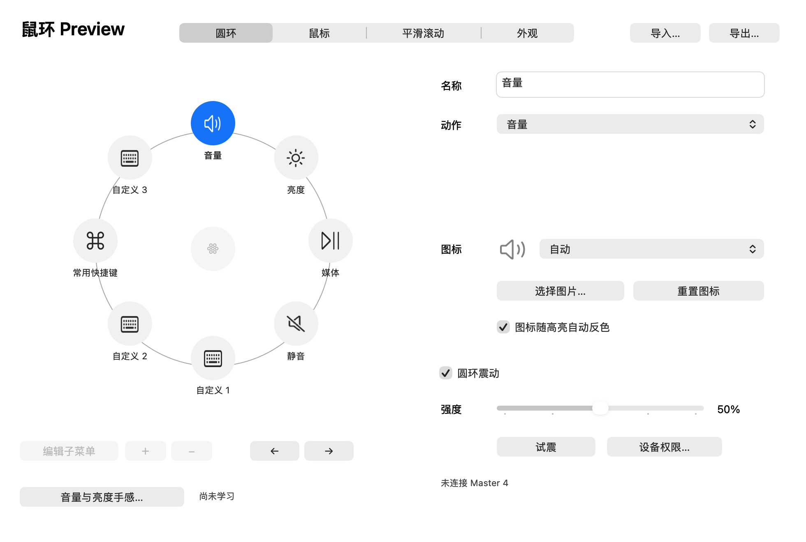
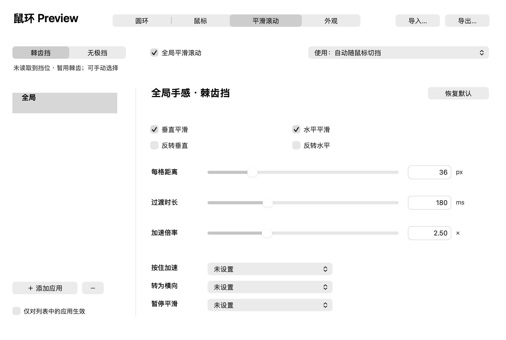

# 鼠环 · MouseRing

**给 Mac 鼠标加上触控板式缩放、可学习的滚轮和一个随手可用的动作圆环。**

你可能只是想在看文档时轻轻放大、滚动时少一点突兀，或者用一个侧键完成复制、粘贴、调音量。鼠环把这些操作放到鼠标上：按住一个键再滚动，或呼出圆环，指向你要的功能。

免费、开源、本地运行。没有账号、广告、遥测或额外后台更新进程。使用原生 macOS 界面，无需 Electron。

> 当前版本：**1.0 Preview 4（构建 19）**，仍是预览版。提供 **Apple Silicon / macOS 27 及以上**构建。下载前请先确认你的 Mac 符合要求。

## 它能帮你做什么

### 像触控板一样放大

按住你选定的鼠标键，转动滚轮，就能发送 macOS 原生的**捏合缩放手势**。

这和反复发送 `⌘+` / `⌘−` 的键盘缩放不同：在支持捏合的应用里，你可以连续地靠近细节、缩回全貌。无需伸手去摸触控板。缩放效果取决于目标应用自身是否支持捏合；不同应用的表现可能不同。

### 让软件学习你的滚轮

不同鼠标、不同驱动，一格滚轮上报的数据可能不同；同一个物理刻度还可能拆成几次事件。直接把“收到一次事件”当“一格”，容易忽快忽慢，调亮度时也可能一下跳过头。

打开“缩放手感…”或“音量与亮度手感…”，切到有卡点的齿格挡，**逐格慢滚**。默认向上 10 格、再向下 10 格，界面用小格子显示进度，会自动进入下一轮，完成后保存。每轮数量可自定义为 **1–100 格**。

学习后，缩放或调节会按采集到的物理刻度单位计算。**缩放与圆环内音量／亮度的学习独立保存、独立重置**，并显示学习时间和格数。快速空转不适合校准；首格请完整、缓慢地滚过。侧滚轮不参与这项学习。

### 一个圆环，放下常用操作



把一个鼠标键设成“打开圆环”，常用操作就能出现在指针附近。

- 八个位置可分别设置动作、名称、快捷键和图标。
- 支持二级菜单，把媒体、粘贴方式等相关操作放在一起。
- 可放置复制、粘贴、剪切、媒体控制、音量、亮度或你自己的快捷键。
- 指向音量、亮度后滚动即可调节；点击外围收起。
- 设置页面直接点击圆环上的项目编辑，位置与实际使用对应。

### 自定义鼠标键和平滑滚动

同一个鼠标键可以分别设置**单击、按住＋滚轮、按住＋移动**。例如侧键单击打开圆环，按住后滚动用来放大；也可以设为滚轮横移或鼠标平移。先用“识别按键…”确认实际按键编号即可。



平滑滚动可调整滚动距离、过渡时长与加速倍率，支持垂直／水平反转、按住加速、转横向、暂停平滑，也可以为不同应用分别设置。

**棘齿挡与无极挡是两套独立参数**，包含各自的应用列表。页面左上选择“编辑哪套”，右上选择“实际使用哪套”：

- **自动随鼠标切挡**：读取支持设备的模式，随模式切换。
- **固定棘齿挡参数／固定无极挡参数**：立即使用指定参数，适合未读取到挡位、设备不支持或想自行选择的情况。

编辑左边的标签不会强制改变鼠标的硬件挡位。自动模式无法读取设备时会明确显示状态，暂用棘齿参数；此时可手动选择无极参数。SmartShift 因快速甩动而临时释放阻尼，不等于用户切换了保存的滚轮模式。

### Master 4 的额外功能

在支持并成功连接的 Master 4 上，可使用实验性的圆环震动：指向一级项目一次、进入二级项目再一次、点击快速两次，强度可调。

设备适配按公开协议资料单独实现，不需要捆绑运行另一个鼠标工具。真实固件、蓝牙／接收器组合与震动手感仍待更多验证，暂不承诺与 Options+ 的圆环手感完全相同。圆环、自定义按键和缩放功能不要求必须使用 Master 4。

另外还有**直接显示／隐藏桌面**，不依赖 F11 快捷键；亮度采用硬件优先调节，支持的显示配置可在硬件下限以下通过色彩表继续调暗至画面全黑。

## 第一次使用：从这里开始

1. 从 [Releases](https://github.com/RYANZhangRuiEn/Mouse-Utility/releases) 下载 `MouseRing-1.0-Preview-4-macOS.zip`。解压，把“鼠环 Preview.app”放入“应用程序”。
2. 打开应用。**默认静默运行，不会弹出设置窗口**；点击屏幕顶部菜单栏的鼠环图标，选择“设置…”。
3. 根据提示，在 macOS“系统设置 → 隐私与安全性 → 辅助功能”中允许鼠环。Master 4 的设备状态与震动访问可能另需“输入监控”；圆环设置中有“设备权限…”入口。应用不会重置系统授权。
4. 在“鼠标”中点“识别按键…”，按一下你想使用的侧键。可以先把单击设为“打开圆环”，再把“按住＋滚轮”设为缩放。
5. 打开“缩放手感…”完成一轮学习；随后在支持捏合的应用里试用。圆环内音量／亮度的学习入口在“圆环”页面，二者分别保存。
6. 需要时再开启“平滑滚动”，按自己的习惯设置方向和两种挡位。建议从默认距离与时长开始调整。

不想先配按键，也可从菜单栏直接点“打开圆环”。圆环目前不支持键盘快捷键呼出。

关闭设置窗口或按 `Command+Q` 会隐藏界面，后台继续运行。完全退出请从菜单栏选“完全退出鼠环”；“关于”中可以查看版本。若屏幕被调至全黑，可从菜单栏选择“恢复屏幕可见”。

### 如何更新

默认每天向 GitHub 检查一次已发布版本。发现新版本后，鼠环会在自己的窗口中提醒；点“前往 GitHub 下载”，自行下载新安装包，完全退出旧版后替换“应用程序”里的应用即可。按钮映射、学习结果和应用规则会保留。

在顶部菜单栏的鼠环菜单，或设置窗口的应用菜单中，可取消勾选**“自动检查更新”**；关闭后不会发起自动检查。“检查更新…”仍可由你主动使用。自动提醒每个版本只显示一次，菜单中也会标出已发现的新版本；预览版更新同样支持。

这项功能直接读取本仓库的公开 GitHub Releases，不需要账号、通知权限或自建服务器，也不会自动下载或安装。网络不可用时自动检查会静默结束，手动检查会显示提示。只提交源码或标签不会触发更新提醒，需要在 GitHub **发布一个更高版本号的 Release**。旧 Preview 1–3 没有这项功能，需要先手动安装 Preview 4。

## 常见问题

**打开后没有窗口，是没启动吗？** 先看顶部菜单栏图标。本版默认后台启动，从图标进入设置。

**无极挡的调节不生效？** 检查“实际使用的滚动参数”。左边只是编辑标签；自动读取不到时，选择“固定无极挡参数”即可明确启用该套配置。设备权限或协议读取恢复后，可再选择自动。

**开启滚动处理后异常？** 暂时关闭该套配置中的平滑和反转，确认系统滚动恢复，再反馈版本、目标应用、挡位及开关情况。不要同时运行两份鼠环。检测到独立 Mos 正在运行时，内置普通滚动处理会暂停，避免重复处理。

**为什么有些应用不能放大？** 触控板式缩放需要目标应用支持原生捏合；本版不会自动改成键盘缩放。

**普通滚动和滚轮学习用的是同一套数值吗？** 不是。普通滚动使用像素距离／过渡时长；学习用于缩放及圆环的物理刻度换算。改平滑参数不会抹掉学习结果。

**可以用于旧款 Intel Mac 或更早的 macOS 吗？** 当前发行构建仅支持 Apple Silicon / macOS 27+，尚未验证其他组合。

## 预览版说明

- 当前使用本地临时签名，尚未经过 Apple Developer ID 签名或公证。安装前请确认下载来源；更换构建后，macOS 可能需要你重新确认该应用的权限。
- 本次修复增加原生事件队列、目标窗口信息、后台时钟和独立挡位选择的回归验证；真实物理滚轮在不同应用中的体验仍需要实测。具体结果见 [VALIDATION.md](VALIDATION.md)。
- 原生捏合、直接显示桌面、DDC 与色彩表涉及未公开接口或设备行为，系统更新可能影响兼容性；尚不面向 Mac App Store。
- “亮度 0%”表示画面全黑，不代表背光功率归零。HDR、镜像和部分驱动可能限制色彩表；显示器的硬件亮度支持也取决于连接与型号。可选的 BetterDisplay 本地接口不随项目分发。
- 本公开版使用独立的平滑轨迹引擎。标识 `local.mousering.preview`，保留旧公开版配置，与私人构建分开保存；不自动导入其他滚动工具的配置。

## 开源、隐私与开发

项目原创贡献使用 [MIT License](LICENSE)。保留的第三方参考署名见 [THIRD_PARTY_NOTICES.md](THIRD_PARTY_NOTICES.md)，历史来源、独立重写范围与设备协议资料见 [PROVENANCE.md](PROVENANCE.md)。本项目与 Apple、Logitech 没有官方关联或背书。

键鼠事件仅用于即时路由和用户主动设置的快捷键录制，不保存日常键入记录；配置、图标和学习数据保存在本机。更新检查只向 GitHub 请求公开版本信息，不上传个人配置或输入，详见 [PRIVACY.md](PRIVACY.md)。

构建需要支持 macOS 27 SDK 的 Xcode Command Line Tools：

```sh
./build.sh
./test.sh
```

安装包输出到 `dist/`，可用 `MOUSERING_OUTPUT_DIR` 指定其他目录。测试使用内存配置和本地事件，不改变真实显示器亮度或设备模式。宣传片的原创示意绘图与合成配乐工程在 `Promo/`；它是功能示意动画，并非实机录屏。
